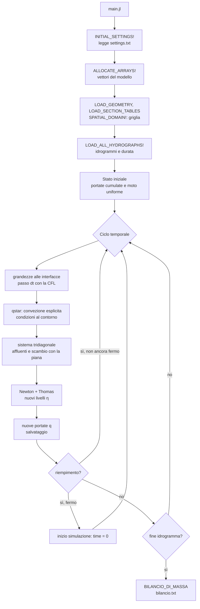

# Resoconto del modello 1D_Brenta

Questo documento spiega come funziona il modello idraulico 1D del fiume Brenta, seguendo il percorso del
codice dal lancio della simulazione fino ai risultati. È pensato per chi apre il progetto per la prima
volta: per ogni passaggio spiega che cosa si calcola, perché, e riporta il pezzo di codice che lo fa.

Il codice è scritto in Julia. I file del modello sono in `Source/`, la configurazione in `settings.txt`,
gli strumenti per grafici e confronti in `strumenti/`. Per lo stato dei risultati e la storia delle
scelte fatte vedi `CLAUDE.md`.

Gli estratti di codice sono presi dai sorgenti; per leggibilità a volte sono leggermente semplificati
(senza le macro di ottimizzazione come `@inbounds`, senza righe commentate, con `...` dove si salta una
parte). I nomi delle funzioni e delle variabili sono quelli veri, quindi si ritrovano con una ricerca nel
codice.

---

## Indice

1. [A cosa serve](#1-a-cosa-serve)
2. [Le equazioni](#2-le-equazioni)
3. [I file del progetto](#3-i-file-del-progetto)
4. [Come si lancia](#4-come-si-lancia)
5. [Il flusso di lavoro in sintesi](#5-il-flusso-di-lavoro-in-sintesi)
6. [Passo 1: lettura di `settings.txt`](#6-passo-1-lettura-di-settingstxt)
7. [Passo 2: geometria, griglia e tabelle delle sezioni](#7-passo-2-geometria-griglia-e-tabelle-delle-sezioni)
8. [Passo 3: idrogrammi e affluenti](#8-passo-3-idrogrammi-e-affluenti)
9. [Passo 4: lo stato iniziale](#9-passo-4-lo-stato-iniziale)
10. [Passo 5: il ciclo temporale](#10-passo-5-il-ciclo-temporale)
11. [Passo 6: lo scambio laterale con la piana](#11-passo-6-lo-scambio-laterale-con-la-piana)
12. [Passo 7: fine del riempimento e bilancio di massa](#12-passo-7-fine-del-riempimento-e-bilancio-di-massa)
13. [I file di uscita](#13-i-file-di-uscita)
14. [Da dove vengono le tabelle: `calcolo_tabelle_daBM`](#14-da-dove-vengono-le-tabelle-calcolo_tabelle_dabm)
15. [Strumenti per grafici e confronti](#15-strumenti-per-grafici-e-confronti)
16. [Glossario delle variabili](#16-glossario-delle-variabili)
17. [Limiti noti](#17-limiti-noti)

---

## 1. A cosa serve

Il modello simula la propagazione di una piena lungo un fiume rappresentato da una sequenza di **sezioni
trasversali** (nel Test_Brenta: 120 sezioni ogni 50 m, da S0050 a S6000). Dato l'idrogramma in ingresso da
monte (portata nel tempo), calcola in ogni sezione e in ogni istante il **livello del pelo libero** e la
**portata**.

Il modello è "1D": in ogni sezione c'è un solo livello e una sola velocità media. Le caratteristiche della
sezione (area bagnata, larghezza, raggio idraulico, scabrezza) non sono descritte con la geometria, ma con
**tabelle** ricavate da un modello 2D (BASEMENT) del tratto: per ogni sezione e per ogni livello la tabella
dice quanto valgono area, larghezza, attrito e così via. Lo scopo del lavoro è avere un modello molto più
veloce del 2D (pochi secondi invece di ore) che ne riproduca il comportamento.

Parole chiave usate nel testo:

| Termine | Significato |
|---|---|
| **sezione** | punto del fiume in cui si calcola il livello (centro di una cella) |
| **interfaccia** | confine tra due celle, dove si calcola la portata |
| **livello** (η, `eta`) | quota del pelo libero [m s.l.m.] |
| **tirante** (h) | livello meno quota del fondo (talweg) [m] |
| **riempimento** (o condizioni iniziali, `IC`) | prima fase del calcolo: il fiume viene portato all'equilibrio con la portata iniziale, poi parte la piena |
| **scambio laterale** | acqua che esce dal canale verso la piana alluvionale o che vi rientra |

---

## 2. Le equazioni

Il modello risolve le **equazioni di de Saint-Venant** in forma 1D, scritte per l'area bagnata `A` e la
portata `Q`:

**Continuità** (conservazione del volume): la variazione di area nel tempo è data dalla differenza tra la
portata che entra e quella che esce dalla cella, più gli apporti laterali (affluenti, scambio con la piana):

```
∂A/∂t + ∂Q/∂x = q_lat
```

**Quantità di moto**: la variazione di portata dipende dal trasporto (termine convettivo), dalla pendenza
del pelo libero e dall'attrito:

```
∂Q/∂t + ∂(β·Q²/A)/∂x + g·A·∂η/∂x + g·A·J = 0
```

dove `β` è il coefficiente di quantità di moto (1 per velocità uniforme nella sezione), `g = 9,81 m/s²` e
`J` è la pendenza d'attrito. L'attrito è scritto alla Manning/Strickler:

```
J = u·|u| / (Ks²·Rh^(4/3))     con u = Q/A
```

Nel codice si usa la quantità `jden = Ks²·Rh^(4/3)/g`, presa direttamente dalla tabella, così che il termine
d'attrito diventa `g·A·J = γ·Q` con

```
γ = |u| / jden
```

`γ` ha le dimensioni di 1/s e si tratta in modo **implicito** (vedi §10.4): è questo che rende lo schema
stabile anche con passi temporali grandi.

### Lo schema semi-implicito

Le equazioni si risolvono con uno **schema semi-implicito alle differenze finite su griglia sfalsata**
(livelli nelle sezioni, portate nelle interfacce):

- il **termine convettivo** è esplicito (calcolato con i valori del passo precedente), con un flusso di tipo
  **Rusanov**;
- l'**attrito** è implicito;
- il **gradiente del pelo libero** è implicito: sostituendo l'equazione della quantità di moto in quella di
  continuità si ottiene un'equazione nei soli livelli `η` del nuovo passo, non lineare (perché `A` dipende
  da `η` tramite le tabelle), che si risolve con il **metodo di Newton**. A ogni iterazione il sistema
  lineare è **tridiagonale** e si risolve con l'**algoritmo di Thomas**.

Il dettaglio è nel §10.

---

## 3. I file del progetto

| Percorso | Contenuto |
|---|---|
| `main.jl` | Punto di partenza: carica il modulo e lancia la simulazione |
| `Source/Run_Simulation.jl` | Modulo `RUN_SIMULATION` che include tutti gli altri file |
| `Source/struct.jl` | `struct Parametri`: tutti i parametri letti da `settings.txt` |
| `Source/module.jl` | Lettura di `settings.txt` (`INITIAL_SETTINGS!`), dimensioni dei file, allocazione dei vettori |
| `Source/subroutines.jl` | Funzioni di servizio: griglia, lettura delle tabelle, moto uniforme, idrogrammi, Thomas, controlli |
| `Source/writing.jl` | Scrittura dei file di uscita e del bilancio di massa |
| `Source/Semi_Implicit_Brenta_2D_1D.jl` | **Il solutore**: stato iniziale, riempimento e simulazione |
| `settings.txt` | Configurazione (letta per posizione, riga per riga) |
| `input/geometria/<caso>/` | Tabelle delle sezioni (`tabella_sezioni.csv`) e geometria (`localslope_xcoord.csv`) |
| `input/idrogrammi/<evento>/` | Idrogrammi `t [s], Q [m³/s]` |
| `output/<caso>/` | Risultati |
| `reference/` | Risultati del modello 2D usati come riferimento |
| `calcolo_tabelle_daBM/` | Script che costruisce le tabelle 1D dai risultati 2D |
| `strumenti/` | Grafici e confronti |
| `calibrazione_scambio/` | Taratura dei parametri dello scambio con la piana |

Il modulo è assemblato così (`Source/Run_Simulation.jl`):

```julia
module RUN_SIMULATION
    using Printf, Parameters, UnPack, Infiltrator, LinearAlgebra, BenchmarkTools

    include("struct.jl")
    include("module.jl")
    include("subroutines.jl")
    include("writing.jl")
    include("Semi_Implicit_Brenta_2D_1D.jl")

    export SEMI_IMPLICIT_BRENTA_2D_1D!
end
```

e `main.jl` si limita a lanciarlo:

```julia
include("Source/Run_Simulation.jl")
using .RUN_SIMULATION
RUN_SIMULATION.SEMI_IMPLICIT_BRENTA_2D_1D!()
```

---

## 4. Come si lancia

Dalla cartella del progetto, con l'ambiente del progetto attivo (`--project=.`):

```bash
julia --project=. -e "using Pkg; Pkg.instantiate()"   # solo la prima volta: installa i pacchetti
julia --project=. -O2 main.jl                        # stato iniziale + simulazione
```

Dalla REPL di Julia: `using Pkg; Pkg.activate(".")` e poi `include("main.jl")`. Se Julia non trova un
pacchetto (es. `Infiltrator`) di solito è perché l'ambiente del progetto non è attivo.

Prima di lanciare si controlla `settings.txt` (vedi §6): soprattutto le righe 1-2 (tabelle e geometria),
14 (idrogramma), 22 (cartella dei risultati) e 27-32 (affluenti e scambio con la piana).

---

## 5. Il flusso di lavoro in sintesi



La stessa funzione, `SEMI_IMPLICIT_BRENTA_2D_1D!`, fa sia il **riempimento** sia la **simulazione**: la
variabile `IC` vale 1 durante il riempimento e 0 dopo. Le differenze tra le due fasi sono poche: portata di
monte costante e passo massimo più piccolo durante il riempimento, file di uscita diversi (`IC_*.csv`).

---

## 6. Passo 1: lettura di `settings.txt`

`settings.txt` è letto **per posizione**: conta il numero di riga, non c'è un'etichetta. Le prime 32 righe
sono la configurazione; dopo ci sono una legenda e vecchie configurazioni, che il modello ignora.

| Riga | Contenuto | Esempio |
|---|---|---|
| 1 | Tabelle delle sezioni | `input/geometria/Test_Brenta/S_50m_q2/tabella_sezioni.csv` |
| 2 | Geometria | `input/geometria/Test_Brenta/S_50m_q2/localslope_xcoord.csv` |
| 3-13 | Idrogrammi degli affluenti Brenta1-6, BrentaNuovo, BrentaVecchio1-4 | |
| 14 | Idrogramma in ingresso da monte | `input/idrogrammi/fittizio_1/piena.csv` |
| 15-21 | Idrogrammi degli affluenti Ceggio, Levico, Centa, Chieppena, Grigno, Maso, Moggio | |
| 22 | Cartella dei risultati (creata se non esiste) | `output/Volume_in_out/fittizio_1` |
| 23 | Ks (non più usato, la riga deve restare) | `33.00` |
| 24 | Tempo iniziale [s] | `0` |
| 25 | Passo temporale massimo [s] | `60` |
| 26 | Numero massimo di passi | `1e9` |
| 27 | Affluenti attivi | `si` / `no` |
| 28 | Scambio laterale con la piana | `sfioro` / `tabella` / `nessuno` |
| 29 | Serbatoio della piana: soglia [m³] | `150000` |
| 30 | Serbatoio della piana: tempo di svuotamento [h] | `0.5` |
| 31 | Serbatoio della piana: ritardo [h] | `1` |
| 32 | Serbatoio della piana: rilascio lento [h] | `32` |

La lettura è in `INITIAL_SETTINGS!` (`Source/module.jl`):

```julia
function INITIAL_SETTINGS!()
    # Legge esattamente 32 righe e rimuove spazi
    righe = open("settings.txt", "r") do f
        [strip(readline(f)) for _ in 1:32]
    end
    parametri_sezioni = righe[1]
    local_slope       = righe[2]
    hydro_files = (brenta1 = righe[3], ..., caldonazzo = righe[14], ..., moggio = righe[21])
    output_dir        = righe[22]
    Ks                = parse(Float64, righe[23])   # non più usato, la riga resta per non spostare le altre
    time              = parse(Float64, righe[24])
    dtmax             = parse(Float64, righe[25])
    Nmax              = round(Int, parse(Float64, righe[26]))
    con_affluenti     = PARSE_SI_NO(righe[27], "riga 27 di settings.txt (affluenti attivi)")
    scambio           = PARSE_SCAMBIO(righe[28])
    V_soglia          = PARSE_NON_NEGATIVO(righe[29], ...)
    T_piana           = 3600.0 * PARSE_NON_NEGATIVO(righe[30], ...)   # ore → secondi
    tau_piana         = 3600.0 * PARSE_NON_NEGATIVO(righe[31], ...)
    T_lento           = 3600.0 * PARSE_NON_NEGATIVO(righe[32], ...)

    # Dimensioni lette dai file: righe e colonne delle tabelle, sezioni dal file della geometria
    n_row, n_col = FILE_SIZE(parametri_sezioni)
    imax, _      = FILE_SIZE(local_slope)
    ...
    return Parametri(parametri_sezioni, local_slope, hydro_files, output_dir, Ks, time, dtmax, Nmax,
                     con_affluenti, scambio, V_soglia, T_piana, tau_piana, T_lento, n_row, imax, n_col)
end
```

Note:

- Il **numero di sezioni** `imax` e la dimensione delle tabelle **non si scrivono a mano**: sono ricavati
  contando le righe dei file (`FILE_SIZE`).
- I valori non validi fermano il programma con un messaggio che indica la riga sbagliata
  (`PARSE_SI_NO`, `PARSE_SCAMBIO`, `PARSE_NON_NEGATIVO`).
- Tutti i parametri finiscono nella `struct Parametri` (`Source/struct.jl`), che il solutore "spacchetta"
  all'inizio con `@unpack`:

```julia
params = INITIAL_SETTINGS!()
@unpack imax, n_col, n_row, Ks, dtmax, Nmax, con_affluenti, scambio, V_soglia, T_piana, tau_piana, T_lento,
        parametri_sezioni, local_slope, output_dir, time = params
```

Subito dopo, `ALLOCATE_ARRAYS!(imax)` crea tutti i vettori del modello, inizializzati a zero: quelli lunghi
`imax` stanno nelle sezioni (es. `eta`, `A_b`), quelli lunghi `imax+1` nelle interfacce (es. `q`, `A_int`).

---

## 7. Passo 2: geometria, griglia e tabelle delle sezioni

### 7.1 La geometria

Il file della geometria (riga 2) ha una riga per sezione:

```
section, local_slope, x_coord_[m], talweg_[m], argine_dx_[m], argine_sx_[m]
```

- `local_slope`: pendenza del fondo (negativa verso valle; nel codice si usa il valore assoluto);
- `x_coord`: ascissa della sezione lungo il fiume;
- `talweg`: quota del punto più basso della sezione (serve per il tirante);
- `argine_dx`, `argine_sx`: quote delle sommità arginali (facoltative; servono allo sfioro).

```julia
function LOAD_GEOMETRY(filename, imax)
    _, n_col = FILE_SIZE(filename)
    data = Array{Float64}(undef, imax, n_col)
    LOAD_DATA!(data, filename, imax, n_col)
    argine_dx = n_col >= 6 ? data[:, 5] : fill(Inf, imax)   # senza argini: Inf, quindi niente sfioro
    argine_sx = n_col >= 6 ? data[:, 6] : fill(Inf, imax)
    return (bx = data[:, 2], x_b = data[:, 3], b_min = data[:, 4], argine_dx, argine_sx)
end
```

### 7.2 La griglia sfalsata

Ogni sezione è il centro di una **cella**; le celle confinano nelle **interfacce**. I livelli si calcolano
nelle sezioni, le portate nelle interfacce:

```
interfaccia:   1        2        3                imax     imax+1
               |   ●    |   ●    |   ●    ...  |    ●    |
sezione:           1        2        3               imax
               q[1]    q[2]     q[3]          q[imax]  q[imax+1]
                  eta[1]   eta[2]   eta[3]        eta[imax]
```

`q[1]` è la portata in ingresso da monte, `q[imax+1]` quella in uscita a valle.

`SPATIAL_DOMAIN!` (`Source/subroutines.jl`) calcola le distanze:

```julia
function SPATIAL_DOMAIN!(imax, x_b, dx_b, x_int, dx_int)
    for i in 1:imax-1
        dx_b[i] = x_b[i+1] - x_b[i]                 # distanza tra due sezioni consecutive
    end
    dx_int[1] = dx_b[1]
    for i in 2:imax-1
        dx_int[i] = 0.5 * (dx_b[i] + dx_b[i-1])     # lunghezza della cella attorno alla sezione i
    end
    dx_int[imax] = dx_b[imax-1]
    for i in 2:imax
        x_int[i] = 0.5 * (x_b[i] + x_b[i-1])        # posizione delle interfacce
    end
    x_int[1]      = -x_int[2]
    x_int[imax+1] = x_b[imax] + (x_b[imax] - x_int[imax])
    return dx_b, dx_int, x_int
end
```

`dx_int` (lunghezza della cella) entra nella continuità, `dx_b` (distanza tra sezioni) nella quantità di
moto.

### 7.3 Le tabelle delle sezioni

Il file delle tabelle (riga 1) contiene, una sotto l'altra, le tabelle di tutte le sezioni. Ogni riga
corrisponde a un livello di una sezione, con livelli crescenti:

| Colonna | Nome | Significato |
|---|---|---|
| 1 | `sezione` | numero della sezione (1 … imax) |
| 2 | `WSE` | **quota del pelo libero** [m s.l.m.] (non il tirante) |
| 3-4 | `Ω`, `Ω_s` | area bagnata [m²] e sua derivata rispetto alla quota |
| 5-6 | `β`, `β_s` | coefficiente di quantità di moto e derivata |
| 7-8 | `jden`, `jden_s` | denominatore dell'attrito `Ks²·Rh^(4/3)/g` e derivata |
| 9-10 | `W`, `W_s` | larghezza del pelo libero [m] e derivata |
| 11-12 | `RH`, `RH_s` | raggio idraulico [m] e derivata |
| 13-14 | `ΔQ`, `ΔQ_s` | (facoltative) scambio con la piana negli scalini 2D e derivata, vedi §11 |

Le colonne `_s` sono le pendenze rispetto alla quota: servono per interpolare linearmente tra una riga e la
successiva.

Le tabelle vengono lette in una matrice e poi **trasposte** (`data[colonna, riga]`), perché in Julia è più
veloce scorrere una colonna di una matrice:

```julia
data_depth = permutedims(LOAD_SECTION_TABLES(parametri_sezioni, n_row, n_col))
first_row, last_row = SECTION_INDEX(data_depth)
ys = copy(data_depth[2, :])           # tutte le quote del pelo libero, una dopo l'altra
SPATIAL_DOMAIN!(imax, x_b, dx_b, x_int, dx_int)
```

- `LOAD_SECTION_TABLES` accetta tabelle a 12 colonne (senza ΔQ: in quel caso aggiunge due colonne di zeri) o
  a 14;
- `SECTION_INDEX` trova dove inizia la tabella di ogni sezione: `first_row[k]` è la prima riga della sezione
  `k`, e `first_row[k+1] - 1` l'ultima;
- `last_row[k]` ricorda l'ultima riga usata per la sezione `k`: siccome il livello cambia poco da un passo
  all'altro, la riga giusta è quasi sempre la stessa o una vicina, e la ricerca è velocissima.

### 7.4 La lettura delle tabelle: `READ_VALUES`

È la funzione chiamata più spesso: dato il livello `eta` della sezione `k`, restituisce area, β, `jden`,
larghezza e raggio idraulico.

```julia
@inline function READ_VALUES(data, ys, first_row, last_row, k, eta)
    lo = first_row[k]
    hi = first_row[k+1] - 1
    z  = max(eta, ys[lo])                          # sotto la prima quota si usa la prima riga
    r  = FIND_ROW(ys, lo, hi, z, last_row[k])      # riga con ys[r] <= z < ys[r+1]
    last_row[k] = r
    d = z - ys[r]
    if r == hi && d > 0.0 && hi > lo
        # oltre l'ultima quota: estrapolazione con la pendenza dell'ultimo tratto
        p  = hi - 1
        dy = ys[hi] - ys[p]
        return (A   = data[3,hi]  + (data[3,hi]  - data[3,p]) /dy*d,
                β   = data[5,hi]  + (data[5,hi]  - data[5,p]) /dy*d,
                den = data[7,hi]  + (data[7,hi]  - data[7,p]) /dy*d,
                w   = data[9,hi]  + (data[9,hi]  - data[9,p]) /dy*d,
                rh  = data[11,hi] + (data[11,hi] - data[11,p])/dy*d)
    end
    # caso normale: interpolazione lineare con le colonne delle derivate
    return (A   = data[3,r]  + data[4,r]*d,
            β   = data[5,r]  + data[6,r]*d,
            den = data[7,r]  + data[8,r]*d,
            w   = data[9,r]  + data[10,r]*d,
            rh  = data[11,r] + data[12,r]*d)
end
```

`FIND_ROW` prova prima l'ultima riga usata e le due vicine; solo se il livello è cambiato molto passa alla
ricerca binaria.

---

## 8. Passo 3: idrogrammi e affluenti

### 8.1 Gli idrogrammi

Ogni idrogramma è un file a due colonne `t [s], Q [m³/s]`. `LOAD_ALL_HYDROGRAPHS!` li legge tutti
(monte e 18 affluenti) in un dizionario, es. `hydro[:caldonazzo].Q`. Tutti i file indicati in
`settings.txt` devono esistere, anche con gli affluenti spenti.

La **durata della simulazione** è il tempo finale più breve tra tutti gli idrogrammi:

```julia
function HYDROGRAPH_END_TIME(hydro)
    t_fin = [v.t[end] for v in values(hydro)]
    tend  = minimum(t_fin)
    maximum(t_fin) != tend && println("Attenzione: tempi finali diversi, uso tend = $tend")
    return tend
end
```

Durante la simulazione la portata di un idrogramma al tempo `time + dt` si calcola con
un'**interpolazione di Lagrange su tre punti** (`LAGRANGE_INTERPOLATION!`), che segue meglio di una
retta le curve dell'idrogramma.

### 8.2 Gli affluenti

Gli affluenti (riga 27 `si`) sono 18, distribuiti uniformemente lungo il tratto. Quelli con picco di almeno
10 m³/s entrano su tre sezioni, gli altri su una:

```julia
n_aff   = 18
sez_aff = [round(Int, k*imax/(n_aff + 1)) for k in 1:n_aff]       # sezione di ingresso
Q_soglia_aff = 10.0
semi_aff = [Q >= Q_soglia_aff ? 1 : 0 for Q in maximum.(Qk_aff)]  # sezioni in più per lato
ncel_aff = 2 .* semi_aff .+ 1                                     # sezioni su cui entra
```

`TRIBUTARY_INFLOW!` distribuisce le portate sulle celle:

```julia
function TRIBUTARY_INFLOW!(Q_aff, Qj, sez_aff, semi_aff, ncel_aff)
    Q_aff .= 0.0
    for j in eachindex(Qj)
        for i in max(1, sez_aff[j] - semi_aff[j]):min(length(Q_aff), sez_aff[j] + semi_aff[j])
            Q_aff[i] += Qj[j] / ncel_aff[j]
        end
    end
    return Q_aff
end
```

Gli affluenti entrano **solo nella continuità** (portano volume, non quantità di moto), vedi §10.6.

---

## 9. Passo 4: lo stato iniziale

Prima della piena il fiume deve essere in uno stato di equilibrio con la portata iniziale. Si parte da una
stima e poi la si lascia assestare (il "riempimento", §12.1).

**La stima iniziale.** Alle interfacce si mette la portata di monte più gli affluenti che entrano a monte
(portate "cumulate"); in ogni sezione il livello è quello di **moto uniforme** per la portata media della
cella:

```julia
q[1] = Qin_IC_target                          # prima portata dell'idrogramma di monte
for i in 1:imax
    q[i+1] = q[i] + Q_aff[i]                  # portata cumulata (Q_aff = 0 senza affluenti)
end
for i in 1:imax
    eta[i] = UNIFORM_LEVEL(data_depth, ys, first_row, last_row, i, 0.5*(q[i] + q[i+1]), bx[i]; y_min = y_ini)
end
```

Il moto uniforme usa lo **stesso attrito delle tabelle** che si usa poi in moto vario. Con `jden` la formula
di Manning diventa

```
Q = A·√(g·jden·S)
```

```julia
UNIFORM_DISCHARGE(A, den, S) = A*sqrt(9.81*den*abs(S))
```

e `UNIFORM_LEVEL` trova per **bisezione** la quota a cui questa portata vale `Q`:

```julia
function UNIFORM_LEVEL(data, ys, first_row, last_row, k, Q, S; y_min = 0.10)
    Qm(e) = (s = READ_VALUES(data, ys, first_row, last_row, k, e); UNIFORM_DISCHARGE(s.A, s.den, S))
    a = ys[first_row[k]] + y_min                 # fondo (+ tirante minimo)
    Qm(a) >= Q && return a
    b = ys[first_row[k+1]-1]                     # quota massima della tabella
    for _ in 1:60
        m = 0.5*(a + b)
        Qm(m) < Q ? (a = m) : (b = m)
    end
    return 0.5*(a + b)
end
```

In un fiume reale (sezioni diverse una dall'altra) il moto uniforme sezione per sezione non è ancora
l'equilibrio: ci sono rigurgiti. Per questo segue il riempimento.

---

## 10. Passo 5: il ciclo temporale

Tutto il calcolo avviene in un unico ciclo, ripetuto finché non si raggiunge la fine dell'idrogramma (o il
numero massimo di passi):

```julia
@time while nCS < Nmax
    qn .= q                       # portata del passo precedente (serve al criterio di fine riempimento)
    CFL = IC == 1 ? 0.6 : 0.95    # numero di Courant: più prudente durante il riempimento
    ...
end
```

### 10.1 Grandezze alle interfacce

Le tabelle danno i valori nelle sezioni (`A_b`, `β_b`, `den_γ_b`, `rh_b`); servono anche alle interfacce,
dove stanno le portate. Area e attrito si prendono dalla cella **a monte** (*upwind*), β e raggio idraulico
come media delle due celle:

```julia
for i in 2:imax
    A_int[i]     = q[i] >= 0.0 ? A_b[i-1] : A_b[i]           # upwind
    β_int[i]     = 0.5 * (β_b[i] + β_b[i-1])                 # media
    den_γ_int[i] = q[i] >= 0.0 ? den_γ_b[i-1] : den_γ_b[i]   # upwind
    rh_int[i]    = 0.5 * (rh_b[i] + rh_b[i-1])
    uf[i]   = q[i] * A_int[i]/(A_int[i]^2 + tol)             # velocità
    smax[i] = abs(β_int[i] * uf[i])                          # velocità di propagazione per Rusanov
end
```

Perché l'upwind: con la media e celle lunghe rispetto al rapporto tirante/pendenza compare un "dente di sega"
nei tratti poco profondi. L'upwind lo elimina (vedi `CLAUDE.md`, "Il metodo numerico").

### 10.2 Il passo temporale

Il passo `dt` è il più grande compatibile con la condizione di Courant (CFL) e con il passo massimo
(`dt_riempimento = 5` s nel riempimento, riga 25 di `settings.txt` dopo):

```julia
amax   = maximum(smax)
dt_lim = IC == 1 ? dt_riempimento : dtmax
dt     = min(dt_lim, CFL*dx/(amax + tol))
CHECK_NAN("calcolo di dt", nCS, time, IC; dt, uf, smax)
if time + dt >= tend
    dt = tend - time           # l'ultimo passo arriva esattamente alla fine
end
if time >= tend
    break
end
```

### 10.3 La parte esplicita: `qstar` e condizioni al contorno

`qstar` è la portata "provvisoria" che contiene solo la parte esplicita della quantità di moto (il
trasporto). La portata finale si otterrà aggiungendo il gradiente del pelo libero e l'attrito (§10.8).

```julia
for i in 1:imax+1
    if i == 1
        # monte: portata dell'idrogramma (costante durante il riempimento)
        qstar[i] = IC == 1 ? Qin_IC_target : LAGRANGE_INTERPOLATION!(nr_hydro, tk_cald, Qk_cald, time, dt)
    elseif i == imax+1
        # valle: moto uniforme con l'attrito della tabella dell'ultima sezione
        qstar[i] = UNIFORM_DISCHARGE(A_int[i], den_γ_int[i], bx[imax])
    else
        # interne: flusso convettivo di tipo Rusanov
        fp = 0.5*(β_int[i]*uf[i]*q[i] + β_int[i+1]*uf[i+1]*q[i+1]) - 0.5*2*max(smax[i], smax[i+1])*(q[i+1]-q[i])
        fm = 0.5*(β_int[i-1]*uf[i-1]*q[i-1] + β_int[i]*uf[i]*q[i]) - 0.5*2*max(smax[i-1], smax[i])*(q[i]-q[i-1])
        qstar[i] = q[i] - dt/dx_b[i-1]*(fp - fm)
    end
    γ[i]       = abs(uf[i])/(den_γ_int[i] + 1e-14)     # coefficiente d'attrito
    A_int_g[i] = A_int[i]/(1.0 + dt*γ[i])             # area "smorzata" dall'attrito implicito
end
```

- **Monte**: la portata imposta è quella dell'idrogramma.
- **Valle**: la portata in uscita è di moto uniforme con il `jden` della tabella dell'ultima sezione e la sua
  pendenza. Siccome `calcolo_tabelle_daBM` ricava quel `jden` proprio con questa pendenza, la portata in
  uscita segue la scala di deflusso (relazione livello-portata) del modello 2D nell'ultima sezione.
- **Flusso di Rusanov**: è la media dei flussi `β·u·Q` delle due celle meno un termine di diffusione
  numerica proporzionale alla velocità massima. Rende stabile la parte convettiva.

### 10.4 Perché l'attrito è implicito

La quantità di moto discretizzata nell'interfaccia `i` è

```
q_i^(n+1) = qstar_i − g·A_int·dt/dx_b·(η_i − η_(i−1))^(n+1) − dt·γ_i·q_i^(n+1)
```

L'attrito `γ·q` è calcolato con la portata **nuova**, quindi

```
q_i^(n+1) = [qstar_i − g·A_int·dt/dx_b·(η_i − η_(i−1))^(n+1)] / (1 + dt·γ_i)
```

Il denominatore `1 + dt·γ` non va mai a zero né cambia segno: anche con attrito molto grande e `dt` grande la
portata viene smorzata ma non oscilla. È per questo che si usa `A_int_g = A_int/(1 + dt·γ)`.

### 10.5 Il sistema per i livelli

Mettendo la formula di `q^(n+1)` nella continuità della cella `i`

```
A_i(η_i^(n+1)) = A_i^n − dt/dx_int·(q_(i+1)^(n+1) − q_i^(n+1)) + dt/dx_int·(Q_aff + Q_lat)
```

si ottiene un'equazione che lega il livello della sezione `i` solo a quelli delle sezioni vicine `i−1` e
`i+1`:

```
A_i(η_i) + aa_i·η_(i−1) + bb_i·η_i + cc_i·η_(i+1) = rhs_i
```

con i coefficienti

```julia
for i in 2:imax-1
    aa[i]  = -g*dt^2/(dx_int[i]*dx_b[i-1])*A_int_g[i]
    cc[i]  = -g*dt^2/(dx_int[i]*dx_b[i])*A_int_g[i+1]
    bb[i]  = -aa[i] - cc[i]
    rhs[i] = A_bn[i] - dt/dx_int[i]*(qstar[i+1]/(1+dt*γ[i+1]) - qstar[i]/(1+dt*γ[i]))
end
```

Nella prima e nell'ultima cella mancano rispettivamente il vicino a monte e quello a valle, e le portate al
contorno (`qstar[1]`, `qstar[imax+1]`) entrano direttamente nel termine noto:

```julia
aa[1]  = 0.0
cc[1]  = -g*dt^2/(dx_int[1]*dx_b[1])*A_int_g[2]
bb[1]  = -aa[1] - cc[1]
rhs[1] = A_bn[1] - dt/dx_int[1]*(qstar[2]/(1+dt*γ[2]) - qstar[1])
aa[imax]  = -g*dt^2/(dx_int[imax]*dx_b[imax-1])*A_int_g[imax]
cc[imax]  = 0.0
bb[imax]  = -aa[imax] - cc[imax]
rhs[imax] = A_bn[imax] - dt/dx_int[imax]*(qstar[imax+1] - qstar[imax]/(1+dt*γ[imax]))
```

### 10.6 Gli affluenti nel termine noto

Gli affluenti si aggiungono al termine noto della continuità (volume entrato in `dt` diviso per la lunghezza
della cella):

```julia
if con_affluenti
    if IC == 1
        TRIBUTARY_INFLOW!(Q_aff, Q_aff_IC, sez_aff, semi_aff, ncel_aff)           # prima portata
    else
        for j in eachindex(Q_aff_t)
            Q_aff_t[j] = LAGRANGE_INTERPOLATION!(length(tk_aff[j]), tk_aff[j], Qk_aff[j], time, dt)
        end
        TRIBUTARY_INFLOW!(Q_aff, Q_aff_t, sez_aff, semi_aff, ncel_aff)
    end
    for i in 1:imax
        rhs[i] += dt/dx_int[i] * Q_aff[i]
    end
end
```

Allo stesso modo entra lo **scambio con la piana** `Q_lat` (positivo se entra, negativo se esce): è
descritto nel §11 perché ha diverse varianti.

### 10.7 Newton + Thomas: i nuovi livelli

L'equazione del §10.5 non è lineare, perché l'area `A_i(η_i)` dipende dal livello tramite la tabella. Si
risolve con il **metodo di Newton**: si cerca il livello che annulla il residuo

```
f_i(η) = A_i(η_i) + aa_i·η_(i−1) + bb_i·η_i + cc_i·η_(i+1) − rhs_i
```

A ogni iterazione si linearizza: la derivata di `A_i` rispetto a `η_i` è la larghezza del pelo libero `W`
(colonna 9 della tabella), quindi la matrice del sistema è tridiagonale con diagonale principale
`W_i + bb_i` e diagonali `aa`, `cc`:

```julia
for iNewton in 1:100
    for i in 1:imax
        sec = READ_VALUES(data_depth, ys, first_row, last_row, i, eta[i])
        A_bn[i] = sec.A
        dA[i]   = sec.w                                  # dA/dη = larghezza
        if i == 1
            ff[i] = A_bn[i] + bb[i]*eta[i] + cc[i]*eta[i+1] - rhs[i]
        elseif i == imax
            ff[i] = A_bn[i] + aa[i]*eta[i-1] + bb[i]*eta[i] - rhs[i]
        else
            ff[i] = A_bn[i] + aa[i]*eta[i-1] + bb[i]*eta[i] + cc[i]*eta[i+1] - rhs[i]
        end
        di[i] = dA[i] + bb[i]                            # diagonale principale
        if rh_int[i] + rh_int[i+1] < 1e-3                # cella asciutta: livello fermo
            di[i] = 1.0
            ff[i] = 0.0
        end
    end
    res = sqrt(sum(ff.^2))
    if res < tol
        break
    end
    THOMAS_ALGORITHM!(imax, aa, cc, di, ff, deta)       # risolve il sistema tridiagonale
    CHECK_NAN("Thomas, iterazione di Newton $iNewton", nCS, time, IC; ff, di, deta)
    eta .= eta .- deta                                   # correzione di Newton
end
```

L'**algoritmo di Thomas** è l'eliminazione di Gauss specializzata per matrici tridiagonali: costa un numero
di operazioni proporzionale al numero di sezioni.

```julia
function THOMAS_ALGORITHM!(imax, aa, cc, di, ff, deta)
    cn = Vector{Float64}(undef, imax); fn = Vector{Float64}(undef, imax)
    cn[1] = cc[1]/di[1]
    fn[1] = ff[1]/di[1]
    for i in 2:imax                          # andata: elimina la diagonale inferiore
        gn = di[i] - cn[i-1]*aa[i]
        cn[i] = cc[i]/gn
        fn[i] = (ff[i] - aa[i]*fn[i-1])/gn
    end
    deta[imax] = fn[imax]
    for i in (imax-1):-1:1                   # ritorno: sostituzione all'indietro
        deta[i] = fn[i] - cn[i]*deta[i+1]
    end
    return deta
end
```

### 10.8 Le nuove portate

Con i livelli nuovi si calcolano le portate alle interfacce, con la formula del §10.4:

```julia
q[1] = qstar[1]
q[imax+1] = qstar[imax+1]
for i in 2:imax
    q[i] = (qstar[i] - g*A_int[i]*dt/dx_b[i-1]*(eta[i]-eta[i-1]))/(1.0 + dt*γ[i])
end
CHECK_NAN("aggiornamento delle portate", nCS, time, IC; q)
```

### 10.9 Avanzamento, salvataggio e aggiornamento delle tabelle

```julia
time  += dt
t_tot += dt                     # tempo dall'inizio, riempimento compreso
nCS   += 1
...
if IC == 1
    save_Q!(out.IC_Q, q); save_time!(out.IC_time, time); save_eta!(out.IC_eta, eta)
    save_h!(out.IC_h, eta .- b_min); save_Q!(out.IC_Q_lat, Q_lat)
else
    save_Q!(out.Q, q); save_time!(out.time, time); save_eta!(out.eta, eta)
    save_h!(out.h, eta .- b_min); save_Q!(out.Q_lat, Q_lat)
end
# area, β, attrito, larghezza e raggio idraulico ai nuovi livelli, per il passo successivo
for i in 1:imax
    sec = READ_VALUES(data_depth, ys, first_row, last_row, i, eta[i])
    A_b[i] = sec.A; β_b[i] = sec.β; den_γ_b[i] = sec.den; b[i] = sec.w; rh_b[i] = sec.rh
end
```

### 10.10 Il controllo dei NaN

Dopo ogni fase delicata `CHECK_NAN` controlla i vettori appena calcolati. Se trova un NaN ferma il programma
indicando fase, passo, tempo e posizioni:

```julia
function CHECK_NAN(fase, nCS, time, IC; vettori...)
    for (nome, v) in vettori
        idx = findall(isnan, v)
        if !isempty(idx)
            error("NaN in $nome dopo $fase: passo $nCS (" * (IC == 1 ? "condizioni iniziali" : "simulazione") *
                  "), t = $time s, posizioni $(idx[1:min(end,10)]) ($(length(idx)) in totale)")
        end
    end
end
```

---

## 11. Passo 6: lo scambio laterale con la piana

Durante una piena l'acqua può superare gli argini e uscire nella piana, e in alcuni punti l'acqua della
piana rientra nel fiume. Il modello lo rappresenta con una portata laterale `Q_lat` per cella, positiva se
l'acqua entra e negativa se esce. Come gli affluenti, entra solo nella continuità ed è **esplicita** (usa i
livelli del passo precedente):

```julia
rhs[i] += dt/dx_int[i] * Q_lat[i]
```

La riga 28 di `settings.txt` sceglie come calcolarla.

### 11.1 `sfioro`: sfioro sugli argini (solo uscita)

Ogni argine superato fa uscire acqua secondo la formula dello stramazzo a parete grossa
(formula 16 di Siviglia, Stocchino e Colombini, ASCE 2009), applicata a tutta la lunghezza della cella:

```
q_l = Cd·√(2g·Y0³)     [m²/s],   Y0 = livello − quota dell'argine,   Cd = 0,385
```

```julia
@inline function FREE_OVERFLOW(eta, z_argine, Cd, g)
    Y0 = max(eta - z_argine, 0.0)
    return Cd*sqrt(2.0*g*Y0^3)
end

if scambio == :sfioro
    for i in 1:imax
        Q_lat[i] = -(FREE_OVERFLOW(eta[i], argine_dx[i], Cd, g) + FREE_OVERFLOW(eta[i], argine_sx[i], Cd, g))*dx_int[i]
        rhs[i] += dt/dx_int[i] * Q_lat[i]
    end
```

Limite: l'acqua uscita non torna mai indietro. Nel 2D invece in molti punti rientra.

### 11.2 `tabella`: scambio dagli scalini 2D con il serbatoio della piana

**L'idea.** Le tabelle vengono da simulazioni 2D a portata costante ("scalini"). A moto permanente la portata
può cambiare lungo il fiume solo per lo scambio con la piana, quindi

```
ΔQ = Q della sezione − Q della sezione precedente
```

misurato negli scalini 2D è lo scambio del tratto, con il suo segno, in funzione del livello: negativo dove
l'acqua esce, positivo dove rientra. È la colonna 13 delle tabelle, e `READ_EXCHANGE` la legge come le altre
grandezze (ma oltre l'ultima quota non estrapola):

```julia
@inline function READ_EXCHANGE(data, ys, first_row, last_row, k, eta)
    lo = first_row[k]
    hi = first_row[k+1] - 1
    eta <= ys[lo] && return data[13,lo]
    eta >= ys[hi] && return data[13,hi]
    r = FIND_ROW(ys, lo, hi, eta, last_row[k])
    last_row[k] = r
    return data[13,r] + data[14,r]*(eta - ys[r])
end
```

**Il problema.** Usata così, la tabella fa crescere i rientri con il livello, e il livello cresce con i
rientri: il modello crea acqua e diverge. Nel 2D invece può rientrare solo l'acqua che prima è uscita.

**La soluzione: un serbatoio virtuale per la piana.** L'acqua che esce va in un serbatoio unico per tutto il
tratto; i rientri sono quelli della tabella ma **limitati da quanto il serbatoio può restituire**, e ridotti
tutti della stessa frazione. Il serbatoio ha quattro parametri (righe 29-32):

| Parametro | Significato fisico | Effetto nel codice |
|---|---|---|
| soglia `V_soglia` [m³] | la piana deve riempirsi prima di restituire acqua | rientra solo il volume oltre la soglia |
| `T_piana` [h] | tempo con cui la piana restituisce | rientro al massimo `(V − soglia)/T_piana` |
| ritardo `tau_piana` [h] | tempo per attraversare la piana | l'acqua uscita arriva al serbatoio dopo `tau_piana` |
| rilascio lento `T_lento` [h] | la piana si svuota lentamente anche dopo la piena | la parte sotto la soglia torna al fiume in `T_lento` |

Il calcolo, a ogni passo:

```julia
elseif scambio == :tabella
    Q_esce    = 0.0        # portata uscente totale [m3/s]
    Q_rientro = 0.0        # rientro richiesto dalle tabelle [m3/s]
    for i in 1:imax
        Q_lat[i] = READ_EXCHANGE(data_depth, ys, first_row, last_row, i, eta[i])
        Q_lat[i] < 0.0 ? (Q_esce -= Q_lat[i]) : (Q_rientro += Q_lat[i])
    end
    if tau_piana > 0.0
        # con il ritardo è disponibile solo l'acqua uscita fino a tau_piana fa
        Vu_tot += dt*Q_esce
        push!(t_storia, t_tot + dt); push!(Vu_storia, Vu_tot)
        V_arrivato = VOLUME_AT(t_storia, Vu_storia, t_tot + dt - tau_piana)
        V_oltre    = max(V_arrivato - V_rientrato - V_soglia, 0.0)
        Q_disp     = T_piana > 0.0 ? min(V_oltre/T_piana, V_oltre/dt) : V_oltre/dt
        V_sotto    = clamp(V_arrivato - V_rientrato, 0.0, V_soglia)
    else
        V_oltre   = max(V_piana - V_soglia, 0.0)
        Q_disp    = T_piana > 0.0 ? min(V_oltre/T_piana, V_oltre/dt + Q_esce) : V_oltre/dt + Q_esce
        V_sotto   = clamp(V_piana, 0.0, V_soglia)
    end
    # frazione dei rientri richiesti che il serbatoio può restituire
    f_rientro = Q_rientro > 0.0 ? min(1.0, Q_disp/Q_rientro) : 0.0
    # rilascio lento della parte sotto la soglia
    Q_lento = T_lento > 0.0 ? min(V_sotto/T_lento, V_sotto/dt) : 0.0
    for i in 1:imax
        Q_lat[i] > 0.0 && (Q_lat[i] *= f_rientro)
        T_lento > 0.0 && (Q_lat[i] += Q_lento*w_rientro[i])
        rhs[i] += dt/dx_int[i] * Q_lat[i]
    end
    V_piana     += dt*(Q_esce - f_rientro*Q_rientro - Q_lento)
    V_rientrato += dt*f_rientro*Q_rientro + dt*Q_lento
end
```

- `VOLUME_AT` interpola la storia del volume uscito per sapere quanto ne era uscito `tau_piana` secondi fa.
- Il rilascio lento va nelle sezioni in cui la tabella prevede rientri, con pesi `w_rientro` proporzionali al
  ΔQ massimo positivo di ogni sezione (calcolati una volta all'inizio):

```julia
w_rientro = [max(0.0, maximum(data_depth[13, first_row[k]:first_row[k+1]-1])) for k in 1:imax]
w_rientro ./= max(sum(w_rientro), 1e-12)
```

- In ogni momento il serbatoio contiene esattamente l'acqua uscita e non ancora rientrata: il volume si
  conserva per costruzione (lo controlla `BILANCIO_DI_MASSA`, §12.2).

I valori dei parametri sono stati tarati sui quattro scenari fittizi confrontando con il 2D (soglia
150 000 m³, T 0,5 h, ritardo 1 h, rilascio lento 32 h): codici, risultati e grafici sono in
`calibrazione_scambio/` con il suo `leggimi.md`.

### 11.3 `nessuno`

Nessuno scambio: l'acqua resta tutta nel canale.

---

## 12. Passo 7: fine del riempimento e bilancio di massa

### 12.1 Quando finisce il riempimento

Durante il riempimento (`IC == 1`) la portata di monte è costante. Si considera raggiunto l'equilibrio quando
valgono **tutte insieme** queste condizioni:

- sono passati almeno `T_assestamento = 3600` s;
- la portata non cambia più: `|q − qn| < 0,01 m³/s` in tutte le interfacce;
- il livello è fermo: ogni `T_fermo = 1800` s si confronta con quello di inizio finestra, e deve essere
  cambiato meno di `tol_fermo = 1 mm` in tutte le sezioni;
- la portata in uscita è uguale a quella entrata (monte + affluenti + scambio) entro lo 0,1%.

```julia
if IC == 1
    IC_counter = 0
    for i in 1:imax
        abs(q[i] - qn[i]) < 1e-2 && (IC_counter += 1)
    end
    if time - t_fermo >= T_fermo                      # finestra di controllo del livello
        fermo = true
        for i in 1:imax
            abs(eta[i] - eta_fermo[i]) >= tol_fermo && (fermo = false)
        end
        eta_fermo .= eta
        t_fermo    = time
    end
    Q_in_tot = q[1] + Q_aff_tot + Q_lat_tot
    if IC_counter == imax && time >= T_assestamento && fermo && abs(Q_in_tot - q[imax+1]) < 1e-3*Q_in_tot
        println("Condizioni iniziali raggiunte al tempo: ", nCS, ", time = ", time)
        B_iniziale = sum(A_b .* dx_int)   # volume in alveo all'inizio della simulazione
        IC   = 0                          # inizia la simulazione vera
        nCS  = 1
        time = 0.0
    end
end
```

Da quel momento il tempo riparte da zero e la portata di monte segue l'idrogramma.

### 12.2 Il controllo del bilancio di massa

Durante la simulazione il modello somma, passo per passo, i volumi entrati e usciti:

```julia
B_lat_tutto += dt*Q_lat_tot                      # scambio con la piana, riempimento compreso
if IC == 0
    B_monte += dt*q[1]; B_valle += dt*q[imax+1]; B_aff += dt*Q_aff_tot; B_lat += dt*Q_lat_tot
end
```

Alla fine `BILANCIO_DI_MASSA` (`Source/writing.jl`) verifica che l'acqua si sia conservata:

```
errore = (volume in alveo alla fine − volume all'inizio) − (entrato da monte − uscito a valle + affluenti + scambio)
```

Il volume in alveo è la somma delle aree delle tabelle per la lunghezza delle celle. Il risultato è stampato
e scritto in `bilancio.txt`; oltre lo 0,1% compare un avviso. Con lo scambio `tabella` si controlla anche che
il serbatoio della piana contenga esattamente l'acqua uscita e non ancora rientrata. Esempio (`fittizio_1`,
sfioro):

```
Bilancio di massa della simulazione (dopo il riempimento), volumi in m3
volume in alveo all'inizio                          48960.9
volume in alveo alla fine                           52831.3
entrato da monte                                  2724007.9
uscito a valle                                    2416747.6
entrato dagli affluenti                                 0.0
scambio con la piana (+ entra, − esce)            -303389.8
errore                                                  0.0  (0.0000% del volume da monte)
```

L'aumento del volume in alveo (3 870 m³) è uguale all'entrato meno l'uscito (a valle e dagli argini): il
modello conserva l'acqua.

---

## 13. I file di uscita

Nella cartella della riga 22, separati da spazi, una riga per passo temporale:

| File | Contenuto | Valori per riga |
|---|---|---|
| `Q.csv` | portate alle interfacce [m³/s] | imax+1 (l'ultimo è l'uscita) |
| `eta.csv` | livelli nelle sezioni [m s.l.m.] | imax |
| `h.csv` | tiranti nelle sezioni [m] | imax |
| `Q_lat.csv` | scambio con la piana per sezione [m³/s] (+ entra, − esce) | imax |
| `time.csv` | tempo [s] | 1 |
| `IC_*.csv` | gli stessi file per il riempimento | |
| `bilancio.txt` | bilancio di massa della simulazione | |

---

## 14. Da dove vengono le tabelle: `calcolo_tabelle_daBM`

Lo script `calcolo_tabelle_daBM/src/main.jl` costruisce le tabelle dai risultati del modello 2D a scalini di
portata (una simulazione 2D in cui la portata in ingresso sale a gradini, ciascuno tenuto fino a regime).
Per ogni sezione e per ogni scalino legge dal 2D livello medio, area bagnata, larghezza e portata, e calcola:

- il raggio idraulico `RH = Ω/W`;
- la pendenza del pelo libero `iWSE` tra la sezione a monte e quella a valle (differenze centrate);
- il **Ks equivalente** della sezione, cioè quello che con la formula di Manning dà la portata del 2D:

```julia
function Ks_equivalent(Q, Ω, RH, iWSE)
    (iWSE > 0.0 && Ω > 0.0) || return NaN
    return sqrt( Q^2 / ((Ω * cbrt(RH)^2 )^2 * iWSE) )
end
jden = @. Ks^2 * cbrt(RH)^4 / g
```

- β (1, oppure calcolato dalle velocità del 2D);
- **ΔQ**, la differenza di portata con la sezione precedente allo stesso scalino:

```julia
function discharge_difference(Q, wet)
    ΔQ = zeros(size(Q))
    for j in 2:size(Q, 2), k in axes(Q, 1)
        (wet[k, j] && wet[k, j-1]) && (ΔQ[k, j] = Q[k, j] - Q[k, j-1])
    end
    return ΔQ
end
```

- le colonne delle derivate `_s` per l'interpolazione.

Nell'ultima sezione `jden` è ricavato con la pendenza usata dal modello per la condizione di valle, così la
portata in uscita segue la scala di deflusso del 2D. Le tabelle sono scritte direttamente in
`input/geometria/Test_Brenta/<caso>/`. Dettagli in `CLAUDE.md`, "Costruzione delle tabelle".

---

## 15. Strumenti per grafici e confronti

Tutti si lanciano dalla cartella del progetto e scrivono in `<cartella dei risultati>/grafici`. Leggono
tabelle e geometria dalle righe 1-2 di `settings.txt`, che devono essere quelle della simulazione analizzata.

| N. | Grafico | Script |
|---|---|---|
| 1-6 | condizioni iniziali, idrogrammi, tiranti, profili, estrapolazione, mappe | `grafici_simulazione.jl` |
| 7-8 | confronto con il 2D in S6000, colmo lungo il tratto | `confronto_reference.jl` |
| 9 | animazione della piena 1D e 2D | `animazioni_2D.jl` |
| 10-11 | riempimento | `grafici_spinup.jl` |
| 12-13 | tirante e portata nelle sezioni, 1D e 2D | `confronto_valle.jl` |
| 14 | errore del tirante sezione per sezione | `errore_tirante_sezioni.jl` |
| 15 | conservazione del volume | `grafico_volumi.jl` |

Esempi:

```bash
julia --project=. strumenti/grafici_simulazione.jl output/Volume_in_out/fittizio_1 input/idrogrammi/fittizio_1/piena.csv
julia --project=. strumenti/confronto_reference.jl output/Volume_in_out/fittizio_1 reference/ns_50_fittizio_1_discharge.csv
julia --project=. strumenti/grafico_volumi.jl      output/Volume_in_out/fittizio_1
```

L'elenco completo dei comandi è in `CLAUDE.md`, "Come si usa".

---

## 16. Glossario delle variabili

| Variabile | Dove sta | Significato |
|---|---|---|
| `imax` | — | numero di sezioni |
| `eta` | sezioni | livello del pelo libero [m s.l.m.] |
| `q` | interfacce | portata [m³/s]; `q[1]` ingresso, `q[imax+1]` uscita |
| `qn` | interfacce | portata del passo precedente |
| `qstar` | interfacce | portata provvisoria (solo convezione) |
| `A_b`, `β_b`, `den_γ_b`, `rh_b` | sezioni | area, β, `jden`, raggio idraulico dalle tabelle |
| `A_int`, `β_int`, `den_γ_int`, `rh_int` | interfacce | gli stessi alle interfacce (upwind o media) |
| `uf` | interfacce | velocità `q/A` |
| `smax` | interfacce | velocità di propagazione per il flusso di Rusanov |
| `γ` | interfacce | coefficiente d'attrito `|u|/jden` [1/s] |
| `A_int_g` | interfacce | `A_int/(1 + dt·γ)` |
| `aa`, `bb`, `cc`, `di` | sezioni | diagonali del sistema tridiagonale |
| `rhs`, `ff`, `deta` | sezioni | termine noto, residuo di Newton, correzione dei livelli |
| `bx`, `x_b`, `b_min` | sezioni | pendenza locale, ascissa, talweg |
| `dx_b`, `dx_int` | — | distanza tra sezioni, lunghezza delle celle |
| `data_depth`, `ys` | — | tabelle trasposte, quote del pelo libero delle tabelle |
| `first_row`, `last_row` | sezioni | prima riga di ogni tabella, ultima riga usata |
| `Q_aff`, `Q_lat` | sezioni | affluenti, scambio con la piana [m³/s] |
| `V_piana`, `V_rientrato`, `Vu_tot` | — | serbatoio della piana: contenuto, rientrato, uscito [m³] |
| `IC` | — | 1 durante il riempimento, 0 durante la simulazione |
| `time`, `t_tot`, `dt`, `nCS` | — | tempo (riparte da 0 dopo il riempimento), tempo totale, passo, contatore dei passi |
| `B_*` | — | volumi del bilancio di massa |

---

## 17. Limiti noti

I limiti principali, discussi in dettaglio in `CLAUDE.md` ("Problemi aperti"):

- lo scambio con la piana usa **un solo serbatoio** per tutto il tratto, con parametri tarati sugli stessi
  quattro scenari usati per la verifica;
- gli affluenti entrano solo nella continuità e non sono ancora stati provati insieme allo scambio con la
  piana;
- l'**upwind** su area e attrito insieme è instabile con veli d'acqua molto sottili su tratti lunghi;
- il **Ks equivalente** delle tabelle è ricavato dalla pendenza del pelo libero senza l'altezza cinetica:
  lascia scarti di 1-2 cm nei livelli;
- il metodo di Newton fa sempre fino a 100 iterazioni con tolleranza 10⁻¹⁴, e `THOMAS_ALGORITHM!` alloca due
  vettori a ogni chiamata: c'è margine per rendere il codice più veloce.
