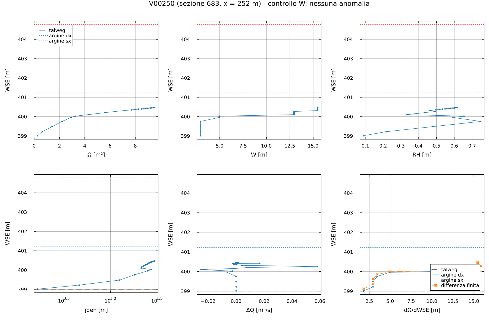
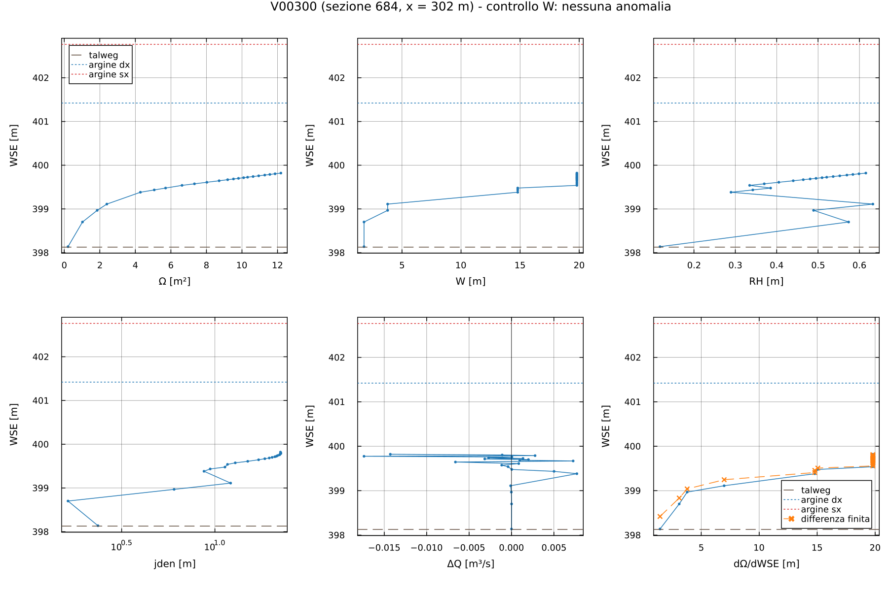
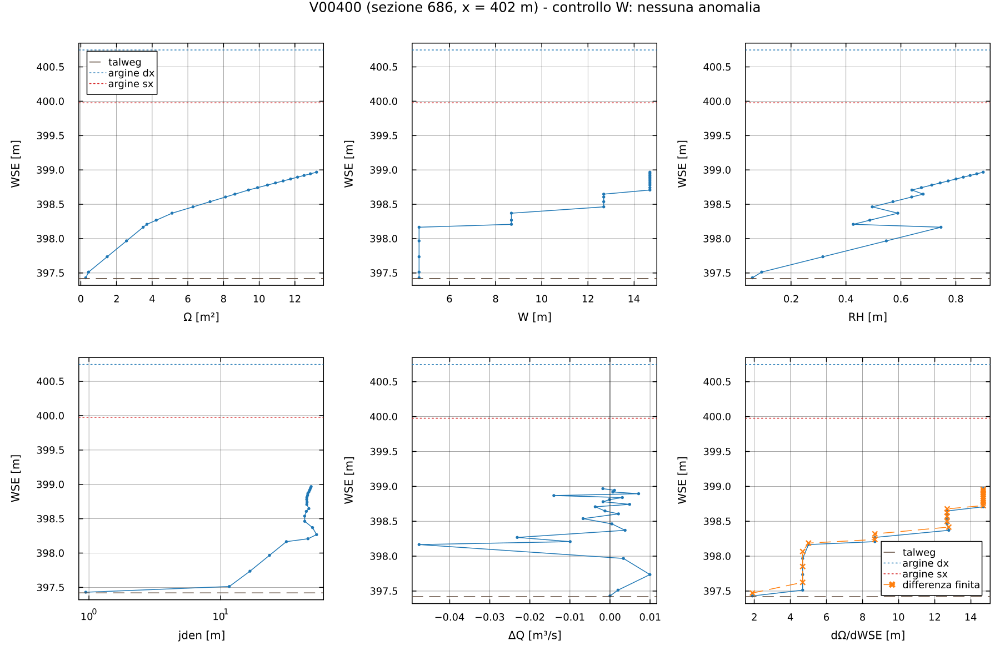
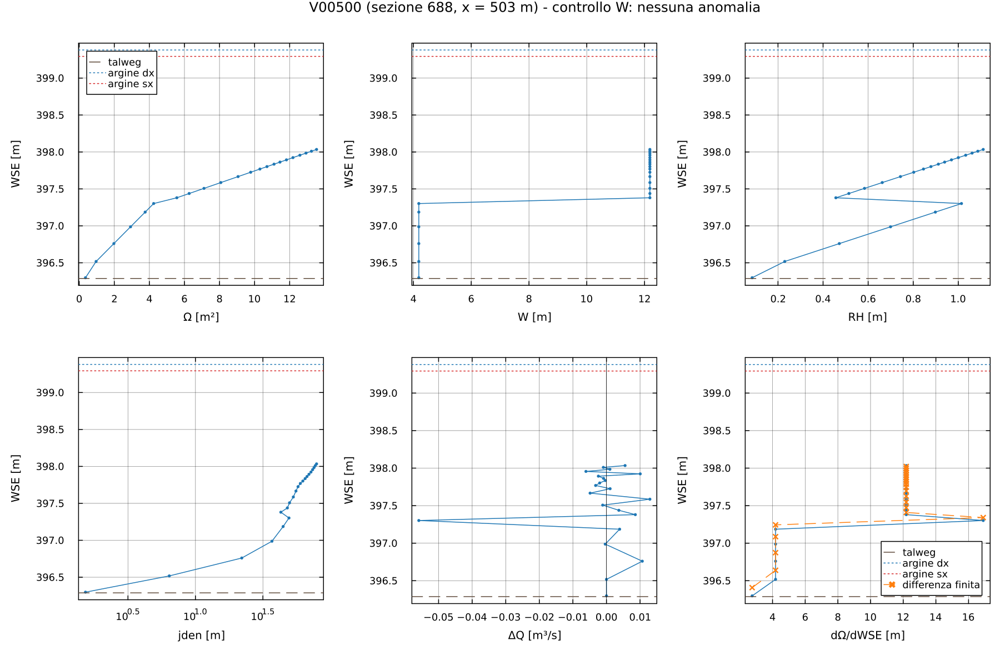
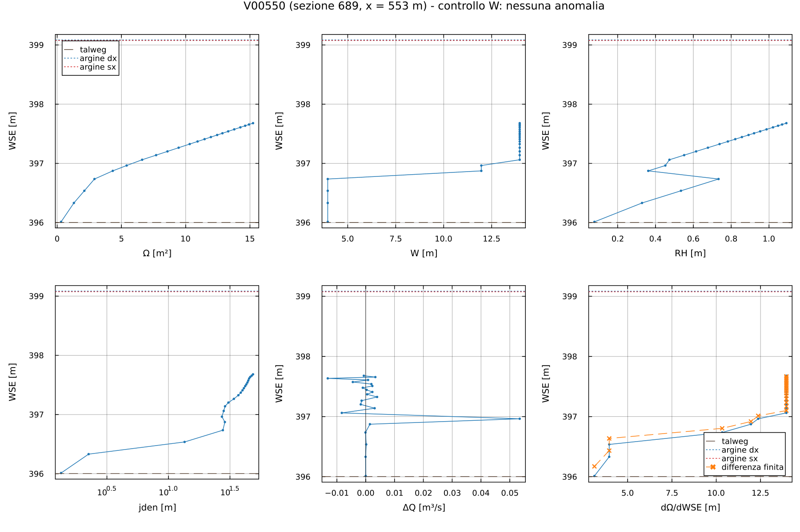
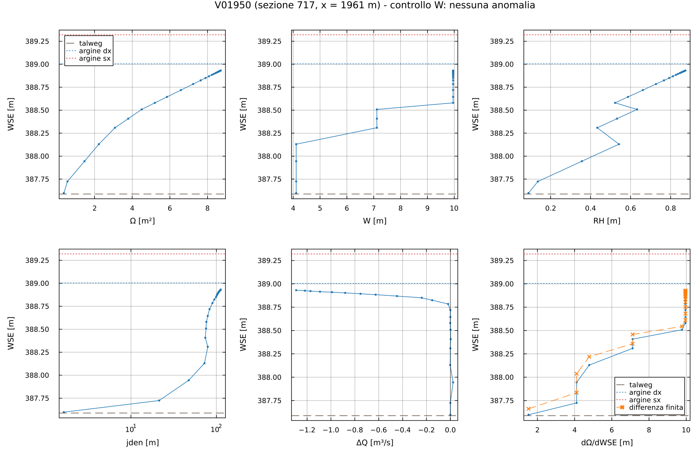
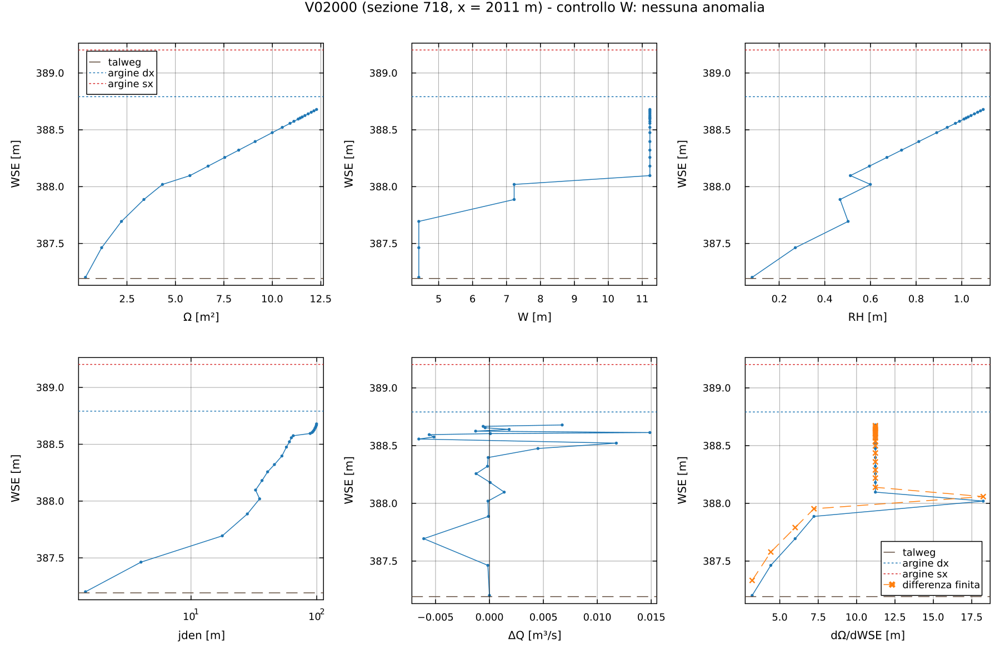

# Controllo della larghezza W - Brenta_completo

Tolleranza sul calo di W: max(0.10 m, 2 % di W). Sezioni controllate: 7.
Sezioni con anomalie: **0** (0 picchi, 0 buchi, 0 cali, 0 con sola derivata negativa).

## V00250 (sezione 683, x = 252 m): nessuna anomalia

| riga | WSE [m] | W [m] | W_s [-] |
|---|---|---|---|
| 1 | 399.015 | 2.949 | 0.00 |
| 2 | 399.222 | 2.949 | 0.00 |
| 3 | 399.485 | 2.949 | 0.00 |
| 4 | 399.753 | 2.949 | 9.61 |
| 5 | 399.961 | 4.949 | 0.00 |
| 6 | 400.025 | 4.949 | 101.01 |
| 7 | 400.104 | 12.949 | 0.00 |
| 8 | 400.161 | 12.949 | 0.00 |
| 9 | 400.206 | 12.949 | 0.00 |
| 10 | 400.267 | 12.949 | 52.49 |
| 11 | 400.315 | 15.477 | 0.00 |
| 12 | 400.350 | 15.477 | 0.00 |
| 13 | 400.371 | 15.477 | 0.00 |
| 14 | 400.387 | 15.477 | 0.00 |
| 15 | 400.401 | 15.477 | 0.00 |
| 16 | 400.410 | 15.477 | 0.00 |
| 17 | 400.422 | 15.477 | 0.00 |
| 18 | 400.434 | 15.477 | 0.00 |
| 19 | 400.446 | 15.477 | 0.00 |
| 20 | 400.454 | 15.477 | 0.00 |
| 21 | 400.461 | 15.477 | 0.00 |
| 22 | 400.469 | 15.477 | 0.00 |

## V00300 (sezione 684, x = 302 m): nessuna anomalia

| riga | WSE [m] | W [m] | W_s [-] |
|---|---|---|---|
| 1 | 398.138 | 1.787 | 0.00 |
| 2 | 398.701 | 1.787 | 7.51 |
| 3 | 398.968 | 3.787 | 0.00 |
| 4 | 399.111 | 3.787 | 40.65 |
| 5 | 399.382 | 14.796 | 0.00 |
| 6 | 399.435 | 14.796 | 0.00 |
| 7 | 399.478 | 14.796 | 81.49 |
| 8 | 399.539 | 19.805 | 0.00 |
| 9 | 399.575 | 19.805 | 0.00 |
| 10 | 399.610 | 19.805 | 0.00 |
| 11 | 399.645 | 19.805 | 0.00 |
| 12 | 399.669 | 19.805 | 0.00 |
| 13 | 399.685 | 19.805 | 0.00 |
| 14 | 399.700 | 19.805 | 0.00 |
| 15 | 399.714 | 19.805 | 0.00 |
| 16 | 399.725 | 19.805 | 0.00 |
| 17 | 399.741 | 19.805 | 0.00 |
| 18 | 399.757 | 19.805 | 0.00 |
| 19 | 399.774 | 19.805 | 0.00 |
| 20 | 399.789 | 19.805 | 0.00 |
| 21 | 399.804 | 19.805 | 0.00 |
| 22 | 399.820 | 19.805 | 0.00 |

## V00400 (sezione 686, x = 402 m): nessuna anomalia

| riga | WSE [m] | W [m] | W_s [-] |
|---|---|---|---|
| 1 | 397.430 | 4.684 | 0.00 |
| 2 | 397.513 | 4.684 | 0.00 |
| 3 | 397.736 | 4.684 | 0.00 |
| 4 | 397.967 | 4.684 | 0.00 |
| 5 | 398.166 | 4.684 | 95.12 |
| 6 | 398.208 | 8.684 | 0.00 |
| 7 | 398.268 | 8.684 | 0.00 |
| 8 | 398.370 | 8.684 | 43.46 |
| 9 | 398.462 | 12.684 | 0.00 |
| 10 | 398.538 | 12.684 | 0.00 |
| 11 | 398.606 | 12.684 | 0.00 |
| 12 | 398.648 | 12.684 | 33.32 |
| 13 | 398.708 | 14.684 | 0.00 |
| 14 | 398.742 | 14.684 | 0.00 |
| 15 | 398.780 | 14.684 | 0.00 |
| 16 | 398.811 | 14.684 | 0.00 |
| 17 | 398.840 | 14.684 | 0.00 |
| 18 | 398.868 | 14.684 | 0.00 |
| 19 | 398.895 | 14.684 | 0.00 |
| 20 | 398.920 | 14.684 | 0.00 |
| 21 | 398.944 | 14.684 | 0.00 |
| 22 | 398.967 | 14.684 | 0.00 |

## V00500 (sezione 688, x = 503 m): nessuna anomalia

| riga | WSE [m] | W [m] | W_s [-] |
|---|---|---|---|
| 1 | 396.298 | 4.186 | 0.00 |
| 2 | 396.518 | 4.186 | 0.00 |
| 3 | 396.760 | 4.186 | 0.00 |
| 4 | 396.987 | 4.186 | 0.00 |
| 5 | 397.186 | 4.186 | 0.00 |
| 6 | 397.302 | 4.186 | 102.33 |
| 7 | 397.380 | 12.186 | 0.00 |
| 8 | 397.438 | 12.186 | 0.00 |
| 9 | 397.507 | 12.186 | 0.00 |
| 10 | 397.586 | 12.186 | 0.00 |
| 11 | 397.667 | 12.186 | 0.00 |
| 12 | 397.726 | 12.186 | 0.00 |
| 13 | 397.769 | 12.186 | 0.00 |
| 14 | 397.802 | 12.186 | 0.00 |
| 15 | 397.835 | 12.186 | 0.00 |
| 16 | 397.863 | 12.186 | 0.00 |
| 17 | 397.893 | 12.186 | 0.00 |
| 18 | 397.924 | 12.186 | 0.00 |
| 19 | 397.956 | 12.186 | 0.00 |
| 20 | 397.985 | 12.186 | 0.00 |
| 21 | 398.010 | 12.186 | 0.00 |
| 22 | 398.034 | 12.186 | 0.00 |

## V00550 (sezione 689, x = 553 m): nessuna anomalia

| riga | WSE [m] | W [m] | W_s [-] |
|---|---|---|---|
| 1 | 396.013 | 3.959 | 0.00 |
| 2 | 396.332 | 3.959 | 0.00 |
| 3 | 396.537 | 3.959 | 0.00 |
| 4 | 396.736 | 3.959 | 58.13 |
| 5 | 396.874 | 11.959 | 0.00 |
| 6 | 396.964 | 11.959 | 20.53 |
| 7 | 397.061 | 13.959 | 0.00 |
| 8 | 397.139 | 13.959 | 0.00 |
| 9 | 397.202 | 13.959 | 0.00 |
| 10 | 397.265 | 13.959 | 0.00 |
| 11 | 397.326 | 13.959 | 0.00 |
| 12 | 397.370 | 13.959 | 0.00 |
| 13 | 397.409 | 13.959 | 0.00 |
| 14 | 397.444 | 13.959 | 0.00 |
| 15 | 397.480 | 13.959 | 0.00 |
| 16 | 397.509 | 13.959 | 0.00 |
| 17 | 397.541 | 13.959 | 0.00 |
| 18 | 397.575 | 13.959 | 0.00 |
| 19 | 397.609 | 13.959 | 0.00 |
| 20 | 397.636 | 13.959 | 0.00 |
| 21 | 397.657 | 13.959 | 0.00 |
| 22 | 397.679 | 13.959 | 0.00 |

## V01950 (sezione 717, x = 1961 m): nessuna anomalia

| riga | WSE [m] | W [m] | W_s [-] |
|---|---|---|---|
| 1 | 387.598 | 4.111 | 0.00 |
| 2 | 387.724 | 4.111 | 0.00 |
| 3 | 387.945 | 4.111 | 0.00 |
| 4 | 388.130 | 4.111 | 16.79 |
| 5 | 388.309 | 7.118 | 0.00 |
| 6 | 388.408 | 7.118 | 0.00 |
| 7 | 388.508 | 7.118 | 39.63 |
| 8 | 388.580 | 9.957 | 0.00 |
| 9 | 388.644 | 9.957 | 0.00 |
| 10 | 388.719 | 9.957 | 0.00 |
| 11 | 388.784 | 9.957 | 0.00 |
| 12 | 388.824 | 9.957 | 0.00 |
| 13 | 388.850 | 9.957 | 0.00 |
| 14 | 388.869 | 9.957 | 0.00 |
| 15 | 388.884 | 9.957 | 0.00 |
| 16 | 388.894 | 9.957 | 0.00 |
| 17 | 388.903 | 9.957 | 0.00 |
| 18 | 388.910 | 9.957 | 0.00 |
| 19 | 388.916 | 9.957 | 0.00 |
| 20 | 388.922 | 9.957 | 0.00 |
| 21 | 388.927 | 9.957 | 0.00 |
| 22 | 388.931 | 9.957 | 0.00 |

## V02000 (sezione 718, x = 2011 m): nessuna anomalia

| riga | WSE [m] | W [m] | W_s [-] |
|---|---|---|---|
| 1 | 387.202 | 4.415 | 0.00 |
| 2 | 387.463 | 4.415 | 0.00 |
| 3 | 387.694 | 4.415 | 14.57 |
| 4 | 387.887 | 7.225 | 0.00 |
| 5 | 388.020 | 7.225 | 51.53 |
| 6 | 388.097 | 11.225 | 0.00 |
| 7 | 388.181 | 11.225 | 0.00 |
| 8 | 388.257 | 11.225 | 0.00 |
| 9 | 388.321 | 11.225 | 0.00 |
| 10 | 388.397 | 11.225 | 0.00 |
| 11 | 388.475 | 11.225 | 0.00 |
| 12 | 388.522 | 11.225 | 0.00 |
| 13 | 388.557 | 11.225 | 0.00 |
| 14 | 388.575 | 11.225 | 0.00 |
| 15 | 388.595 | 11.225 | 0.00 |
| 16 | 388.604 | 11.225 | 0.00 |
| 17 | 388.613 | 11.225 | 0.00 |
| 18 | 388.626 | 11.225 | 0.00 |
| 19 | 388.640 | 11.225 | 0.00 |
| 20 | 388.655 | 11.225 | 0.00 |
| 21 | 388.667 | 11.225 | 0.00 |
| 22 | 388.679 | 11.225 | 0.00 |

