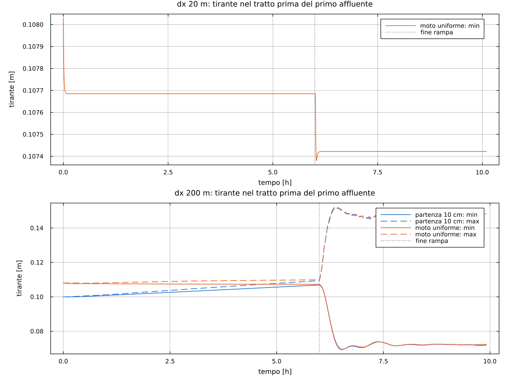
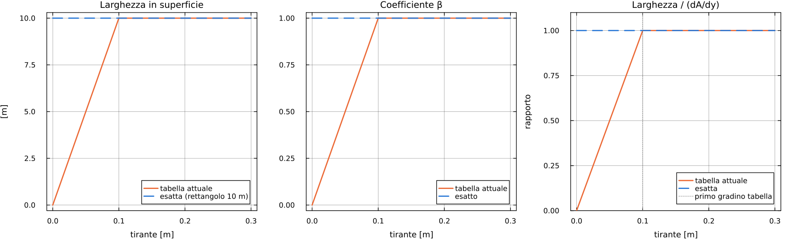
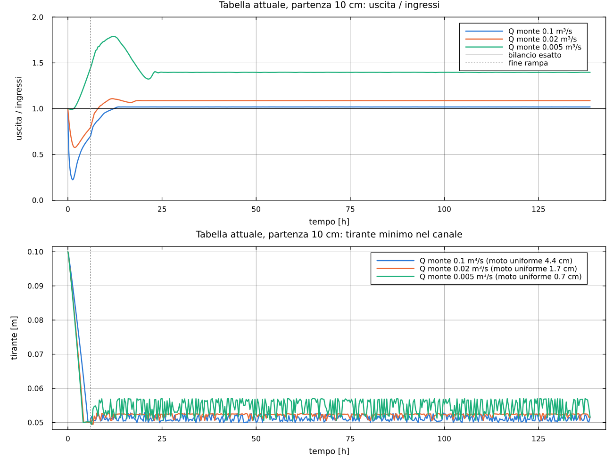
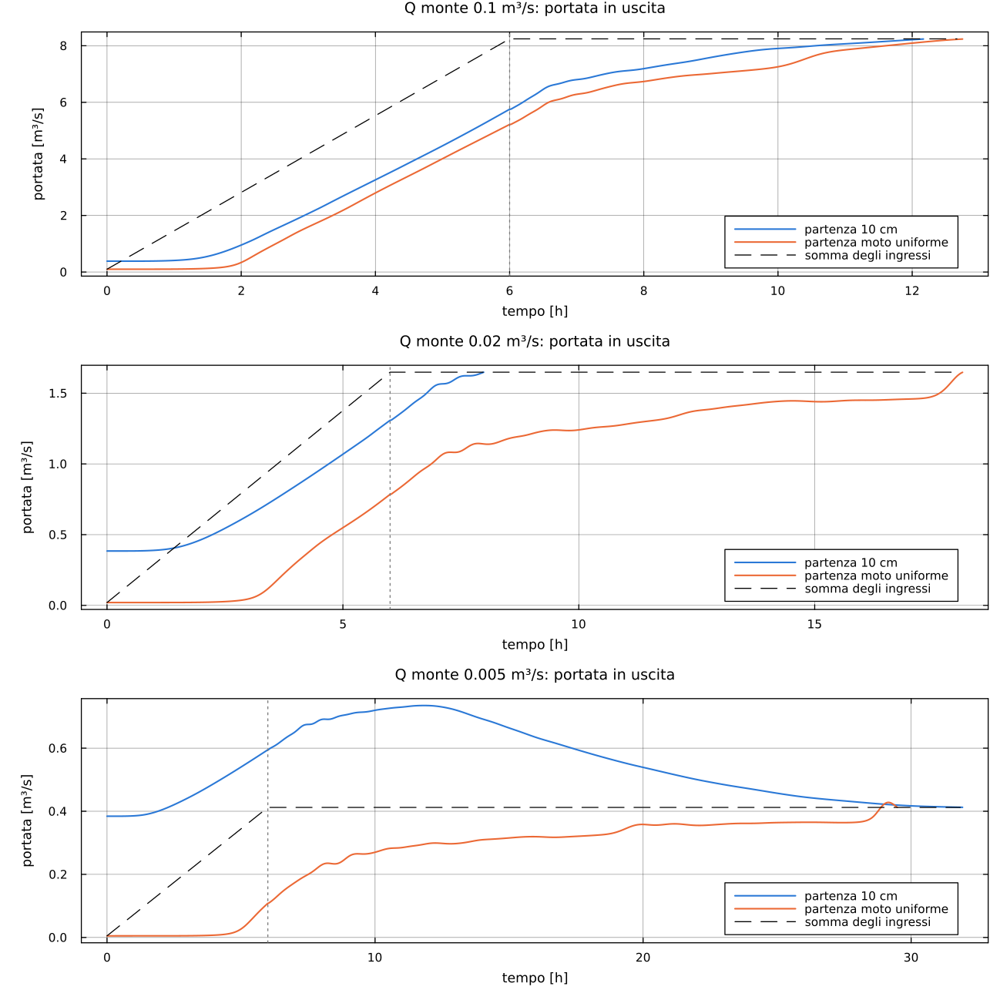
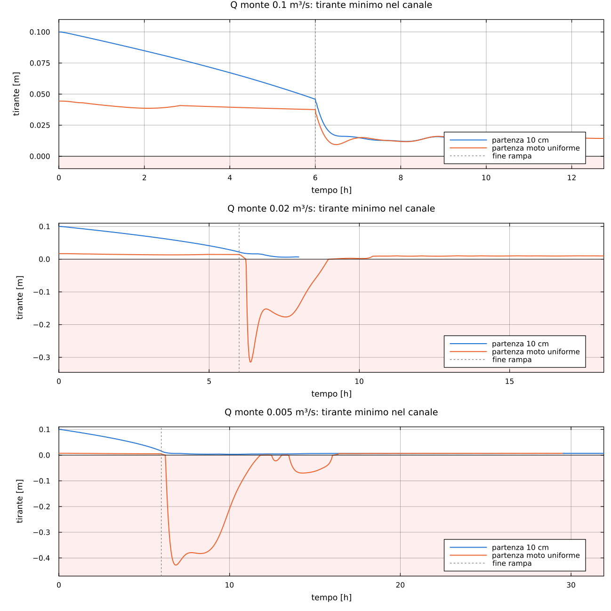
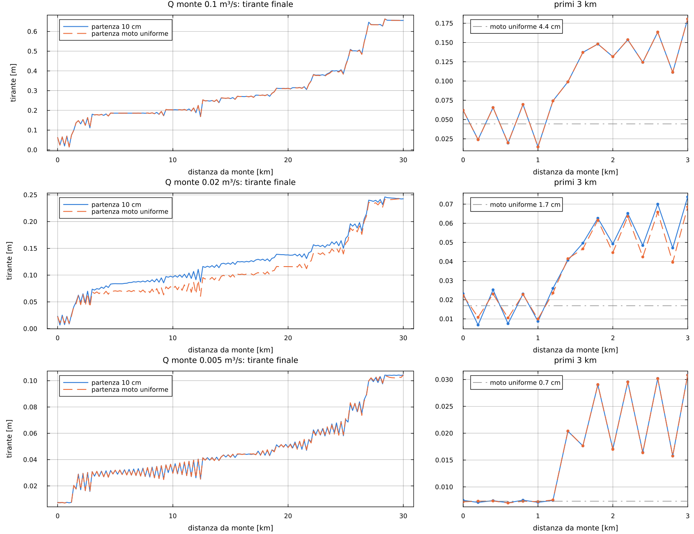

# Partenza da moto uniforme e portate molto basse

Resoconto delle prove sul canale rettangolare di prova (30 km, B = 10 m, pendenza 0,003, Ks = 33).
Tutte le prove sono state fatte su copie temporanee: il codice del progetto non è stato modificato.
Si è simulata solo la fase di riempimento (condizioni iniziali), fermandosi quando sono raggiunte.

## 1. Cosa si è provato

**Partenza attuale.** Velo di 10 cm in tutto il canale con la portata di moto uniforme
corrispondente (0,384 m³/s). In `T_riempimento` = 6 h la portata di monte va in modo lineare al
primo valore dell'idrogramma e gli affluenti salgono da 0 al loro primo valore.

**Partenza da moto uniforme.** In ogni sezione si parte dal tirante di moto uniforme della prima
portata dell'idrogramma di monte, trovato per bisezione sulla tabella:

```julia
function UNIFORM_LEVEL(data, ys, first_row, last_row, k, Q, Ks, S; y_min = 0.10)
    Qm(e) = (s = READ_VALUES(data, ys, first_row, last_row, k, e); s.A*Ks*sqrt(abs(S))*s.rh^(2/3))
    a = ys[first_row[k]] + y_min
    Qm(a) >= Q && return a
    b = ys[first_row[k+1]-1]
    for _ in 1:60
        m = 0.5*(a + b)
        Qm(m) < Q ? (a = m) : (b = m)
    end
    return 0.5*(a + b)
end
```

La portata di monte resta quindi costante fin dall'inizio, mentre gli affluenti salgono come prima.

Le prove fatte:

| Prova | dx | Portata di monte | Tabella |
|---|---|---|---|
| Portata normale | 20 e 200 m | 0,436 m³/s (idrogramma) | attuale |
| Magra, tabella attuale | 200 m | 0,1, 0,02, 0,005 m³/s | attuale |
| Magra, tabella esatta | 200 m | 0,1, 0,02, 0,005 m³/s | esatta, fitta sotto 10 cm |

Nelle prove di magra anche gli affluenti sono ridotti nella stessa proporzione (Q / 0,436), per
simulare una magra su tutto il fiume. I tiranti di moto uniforme corrispondenti sono 4,4, 1,7 e 0,7 cm.
Nelle prove di magra la partenza da moto uniforme è stata usata senza tirante minimo (`y_min = 0`),
per vedere il comportamento del metodo puro.

## 2. Portata normale (0,436 m³/s)

Il tirante di moto uniforme è 10,8 cm, molto vicino ai 10 cm attuali.

| | Durata riempimento attuale | Durata con moto uniforme | Condizione finale: scarto di tirante max |
|---|---|---|---|
| dx 20 m | 36433 s (6882 passi) | 36339 s (6867 passi) | 0,05 mm |
| dx 200 m | 4564 passi | 4564 passi | 3,8 mm |



- **dx 20 m:** il primo tratto parte già nella sua condizione finale: da 10,81 cm arriva a circa
  10,75 cm, meno di un millimetro. La piccola differenza tra il moto uniforme di Manning e quello
  trovato dallo schema dipende dalla discretizzazione.
- **dx 200 m:** le due partenze danno lo stesso risultato. Dopo la rampa il primo tratto si
  seghetta allo stesso modo, perché il dente di sega dipende dal dx e non dallo stato di partenza.

**Conclusione:** a portata normale la partenza da moto uniforme funziona, ma i risultati non cambiano.

## 3. Magra con la tabella attuale: il problema è la tabella

Nella tabella attuale il primo tratto (da 0 a 10 cm) non è fisico: sul fondo larghezza e β valgono
zero e crescono in modo lineare fino a 10 cm. L'area invece è corretta (A = 10·y). Per Newton la
larghezza è la derivata dell'area: sotto i 10 cm la derivata usata è sbagliata, fino a 10 volte più
piccola di quella vera.



Conseguenze:

- **Partenza da moto uniforme:** NaN nel calcolo di Newton entro i primi 35 s, in tutti e tre i casi.
- **Partenza da 10 cm:** nessun NaN, ma il tirante si blocca intorno ai 5 cm qualunque sia la
  portata. Inoltre l'uscita resta stabilmente più alta degli ingressi: la massa non si conserva e le
  condizioni iniziali non vengono mai raggiunte (la simulazione arriva a 139 h ancora in riempimento).

| Portata di monte | Uscita / ingressi a regime | Tirante minimo | Moto uniforme |
|---|---|---|---|
| 0,1 m³/s | 1,02 | circa 5,1 cm | 4,4 cm |
| 0,02 m³/s | 1,09 | circa 5,2 cm | 1,7 cm |
| 0,005 m³/s | 1,40 | tra 5,0 e 5,7 cm, oscillante | 0,7 cm |



**Conclusione:** con la tabella attuale nessuna delle due partenze funziona sotto i 10 cm di tirante.

## 4. Magra con la tabella esatta

La tabella è stata ricalcolata in modo esatto per il rettangolo (larghezza 10 m e β = 1 anche sul
fondo, Rh e `jden` dalle formule). Ha righe fitte vicino al fondo: 0, 0,25, 0,5, 1, 1,5, 2, 3, 4, 5,
6,5, 8 e 10 cm, poi ogni 10 cm. È anche la prima prova del codice con dh non costante.

### Bilancio e durata

Tutte e sei le prove arrivano alla fine del riempimento e il bilancio di massa torna.



| Portata di monte | Durata, partenza 10 cm | Durata, partenza moto uniforme |
|---|---|---|
| 0,1 m³/s | 43800 s (12,2 h) | 45900 s (12,8 h) |
| 0,02 m³/s | 28740 s (8,0 h) | 65280 s (18,1 h) |
| 0,005 m³/s | 114900 s (31,9 h) | 106140 s (29,5 h) |

### Tiranti negativi con la partenza da moto uniforme

Con la partenza da moto uniforme, a 0,02 e 0,005 m³/s, durante il riempimento il tirante diventa
negativo:

- **0,02 m³/s:** per 165 passi, tra 22440 e 32280 s, fino a −0,31 m;
- **0,005 m³/s:** per 523 passi, tra 22500 e 57660 s, fino a −0,43 m.

Succede sempre subito dopo la fine della rampa (21600 s), quando il passo temporale passa da 5 a 60 s
e l'area all'interfaccia torna dall'upwind alla media. Il modello non si ferma perché la lettura
della tabella taglia la quota al fondo, ma in quei passi il risultato non è fisico.

Con la partenza da 10 cm non succede: il tirante minimo resta positivo (0,6 e 0,3 cm). Il velo di
10 cm fa da cuscinetto mentre l'acqua degli affluenti arriva verso valle.



### Condizione finale



- **0,1 e 0,005 m³/s:** le due partenze arrivano allo stesso profilo (scarto massimo 3,6 e 2,1 mm).
- **0,02 m³/s:** nel tratto centrale (da 3 a 25 km) la partenza da moto uniforme termina fino a
  2,7 cm più bassa. Probabilmente il criterio di arresto (|q − qn| < 0,01 m³/s, con portate di circa
  1 m³/s) ferma il riempimento prima che uno dei due casi sia del tutto stazionario. Non è stato
  verificato.
- **Dente di sega:** con tiranti di pochi centimetri, 200 m di cella sono enormi rispetto a y/S e lo
  schema con la media oscilla molto. A 0,1 m³/s nel primo chilometro il tirante va da 1,4 a 7 cm,
  contro i 4,4 cm del moto uniforme. A valle del primo affluente oscilla anche a 0,005 m³/s.

## 5. Conclusioni

1. **La tabella sotto i 10 cm è il problema principale.** Con la tabella attuale il modello non
   simula le magre, qualunque sia la partenza. Le tabelle del Brenta vanno generate con larghezza
   e β corretti sul fondo e con righe fitte vicino al fondo, che il codice ora gestisce.
2. **La partenza da moto uniforme è corretta in principio**, ma sui veli sottilissimi è meno robusta
   di quella da 10 cm: produce tiranti negativi quando, finita la rampa, arriva l'acqua degli
   affluenti. Se la si adotta va tenuto un tirante minimo (`y_min = 0.10`). In magra si torna così di
   fatto alla partenza da 10 cm, che nelle prove è risultata la più robusta.
3. **A portata normale le due partenze sono equivalenti:** la scelta non cambia i risultati.
4. **Il dente di sega con la media cresce in magra:** con dx 200 m e tiranti di pochi centimetri
   l'oscillazione è ampia quanto il tirante stesso. Per le magre serve un dx più piccolo o l'upwind
   (lasciato commentato nel codice).

## Dove sono i file

- Grafici e resoconto: `output/resoconto_magra/`.
- Script e copie delle prove:
  `C:\Users\nicol\AppData\Local\Temp\claude\9f3957e78330259e\43492695-61d0-4f26-9094-81cc30943d0c\scratchpad\dx\`
  - `prova_uniforme.jl`: portata normale;
  - `prova_magra.jl`: magra con la tabella attuale;
  - `prova_magra_fine.jl`: magra con la tabella esatta;
  - `plot_resoconto.jl`: grafici.
